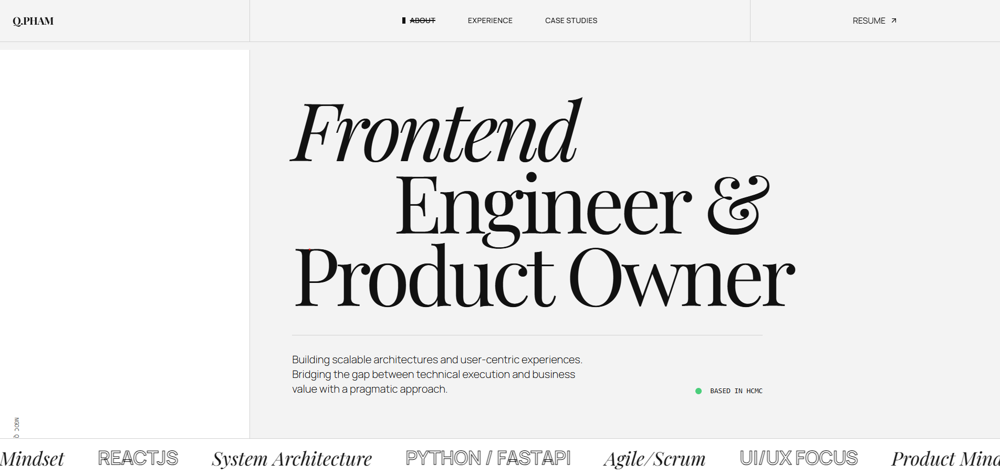
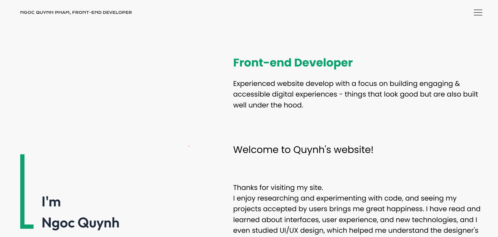
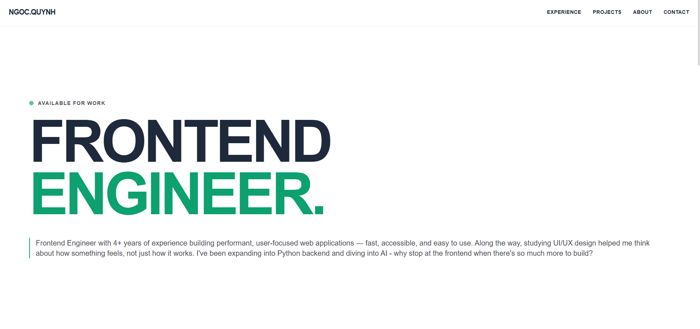

# Portfolio archives

Kho lưu trữ các phiên bản portfolio theo năm. **Nhánh `main` là mục lục** (README + preview) — mã nguồn và site chạy trên từng nhánh năm.

| Nhánh | Mô tả |
|--------|--------|
| [`ver-2024`](https://github.com/ngocquynhpham/portfolio-archives/tree/ver-2024) | Portfolio phiên bản 2024 |
| [`ver-2025`](https://github.com/ngocquynhpham/portfolio-archives/tree/ver-2025) | Portfolio phiên bản 2025 |
| [`ver-2026`](https://github.com/ngocquynhpham/portfolio-archives/tree/ver-2026) | Portfolio phiên bản 2026 cũ |

## Preview

### [ver-2024](https://github.com/ngocquynhpham/portfolio-archives/tree/ver-2024)

[](https://github.com/ngocquynhpham/portfolio-archives/tree/ver-2024)

### [ver-2025](https://github.com/ngocquynhpham/portfolio-archives/tree/ver-2025)

[](https://github.com/ngocquynhpham/portfolio-archives/tree/ver-2025)

### [ver-2026](https://github.com/ngocquynhpham/portfolio-archives/tree/ver-2026)

[](https://github.com/ngocquynhpham/portfolio-archives/tree/ver-2026)

## Chạy local

Checkout nhánh cần xem, rồi:

```bash
git checkout ver-2026   # hoặc ver-2025 / ver-2024
npm install
npm run dev
```

## Deploy

Gắn hosting (Vercel, Netlify, GitHub Pages, …) với **branch tương ứng** — mỗi năm một deployment riêng nếu cần.
